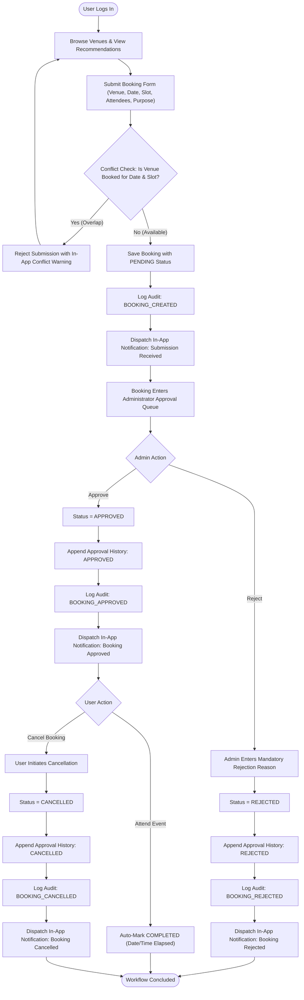
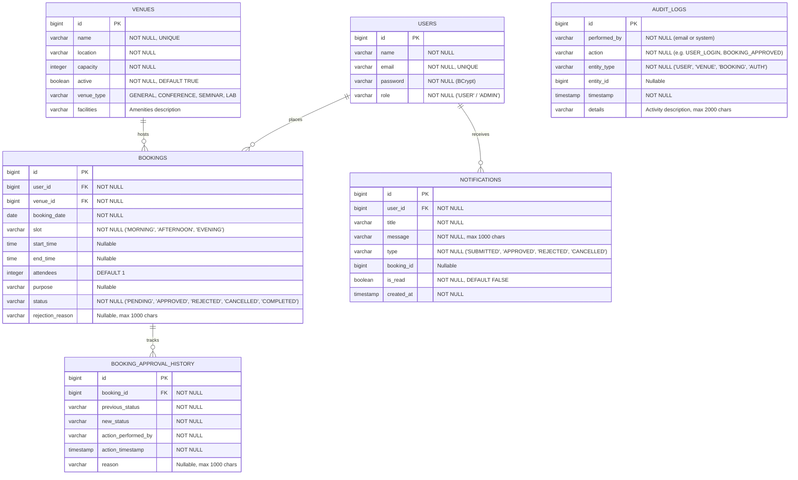
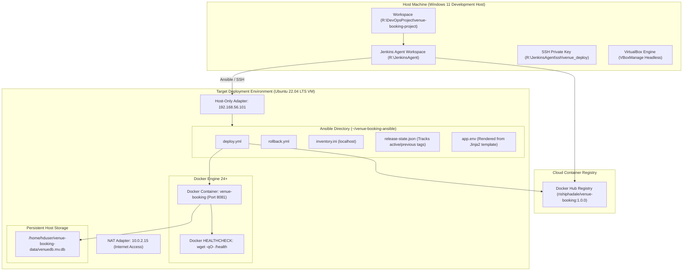

# Venue Resource Booking System

[](file:///r:/DevOpsProject/venue-booking-project)
[](file:///r:/DevOpsProject/venue-booking-project)
[](https://adoptium.net)
[](https://spring.io/projects/spring-boot)
[](https://hub.docker.com/r/rishiphadale/venue-booking)
[](file:///r:/DevOpsProject/venue-booking-project)
[](https://github.com/rishirp15/venue-resource-booking-devops)

An enterprise-grade, Ansible-provisioned Venue Resource Booking System engineered as a complete DevOps portfolio implementation.

The project demonstrates the complete software delivery lifecycle: Agile planning, source control workflows, continuous integration, multi-tier automated testing, hardened containerization, configuration management, automated deployment, zero-data-loss database migration, and self-healing release rollbacks.

---

## Table of Contents

1. [Executive Summary & Problem Statement](#executive-summary--problem-statement)
2. [Technology Stack](#technology-stack)
3. [System Architecture](#system-architecture)
4. [Application Workflow & Lifecycle](#application-workflow--lifecycle)
5. [CI/CD & Test Automation Pipeline](#cicd--test-automation-pipeline)
6. [Database Entity-Relationship Model](#database-entity-relationship-model)
7. [Deployment Architecture](#deployment-architecture)
8. [Core Functional Modules](#core-functional-modules)
9. [DevOps Automation Modules](#devops-automation-modules)
10. [Local Setup & Execution Guide](#local-setup--execution-guide)
11. [Automated Testing Guide](#automated-testing-guide)
12. [Docker Image Lifecycle & Health Checks](#docker-image-lifecycle--health-checks)
13. [Ansible Deployment & Recovery Guide](#ansible-deployment--recovery-guide)
14. [Operational Health Endpoints](#operational-health-endpoints)
15. [Release Management & Audit Summary](#release-management--audit-summary)

---

## Executive Summary & Problem Statement

Modern academic and corporate campuses manage shared physical facilities—such as seminar halls, executive boardrooms, computer laboratories, and collaborative meeting suites. Manual reservation workflows often result in:
- Double bookings and scheduling conflicts.
- Lack of accountability and transparent approval workflows.
- Low venue utilization and opaque capacity matching.
- Absence of auditable records and instant stakeholder notifications.

The **Venue Resource Booking System** solves these challenges by combining a secure, role-based reservation platform with an automated, reproducible CI/CD and configuration management infrastructure.

---

## Technology Stack

| Layer | Component / Technology | Specification & Role |
|---|---|---|
| **Runtime & Language** | Java 21 LTS (Eclipse Temurin) | High-performance, modern Java runtime |
| **Framework** | Spring Boot 3.4.3 | Application container, MVC, dependency injection |
| **Presentation** | Thymeleaf 3, HTML5, Bootstrap/CSS | Server-rendered templates, responsive design |
| **Security** | Spring Security 6 & BCrypt | Session protection, CSRF mitigation, password hashing |
| **Persistence** | Spring Data JPA & Hibernate ORM 6.6 | Object-relational mapping, transactional safety |
| **Databases** | H2 Database & PostgreSQL | Dual-profile architecture (`dev` embedded, `prod` external) |
| **Build & Dependencies** | Apache Maven 3.9+ | Build lifecycle, dependency resolution, WAR packaging |
| **Source Control** | Git & GitHub | GitFlow model, branch protection, PR peer reviews |
| **Continuous Integration** | Jenkins (Controller + Windows Agent) | Declarative multi-stage pipeline, automated gates |
| **Automated Testing** | JUnit 5, Mockito, Spring Test | 112 unit and service integration tests |
| **End-to-End Testing** | Selenium WebDriver & HtmlUnitDriver | 7 automated user journeys with zero display dependencies |
| **Containerization** | Docker Engine & Docker Hub | Versioned OCI runtime image (`rishiphadale/venue-booking`) |
| **Configuration Mgmt** | Ansible 2.14+ | Idempotent deployment playbooks, Jinja2 environment templates |
| **Target Infrastructure** | Ubuntu 22.04 LTS (VirtualBox VM) | Production host environment at `192.168.56.101` |

---

## System Architecture

The following diagram illustrates the component architecture of the Venue Resource Booking System, spanning client requests, MVC controller mapping, business services, security filters, and data persistence.

```mermaid
flowchart TD
    subgraph ClientLayer ["Client Layer"]
        UserBrowser["User Browser (Desktop / Mobile)"]
        AdminBrowser["Admin Console (Browser)"]
    end

    subgraph SecurityBoundary ["Spring Security & Session Boundary"]
        CSRFFilter["CSRF Validation Filter"]
        SessionFilter["HttpSession & Cookie Rotation (SameSite=Lax)"]
        AuthFilter["Role-Based Authorization Filter"]
    end

    subgraph ControllerLayer ["Spring Boot MVC Controllers"]
        HomeController["HomeController (/)"]
        AuthController["AuthController (/login, /register, /logout)"]
        BookingController["BookingController (/book, /my-bookings, /cancel)"]
        AdminController["AdminController (/admin/dashboard, /admin/venues, /admin/audit)"]
        AnalyticsController["AnalyticsController (/my-analytics, /recommendations, /admin/analytics)"]
        NotificationController["NotificationController (/notifications)"]
        HealthController["HealthController (/health)"]
    end

    subgraph ServiceLayer ["Business Logic & Services"]
        VenueService["VenueService (Capacity, Amenities, Status)"]
        BookingService["BookingService (Conflict Detection, Status Engine)"]
        RecommendationService["RecommendationService (Scoring & Allocation)"]
        AnalyticsService["AnalyticsService (Trends, Utilization, Metrics)"]
        AuditLogService["AuditLogService (Event Ledger)"]
        NotificationService["NotificationService (In-App Alerts)"]
        PasswordService["PasswordService (BCrypt Hashing)"]
        EmailService["EmailService (Graceful SMTP Fallback)"]
    end

    subgraph PersistenceLayer ["Spring Data JPA & Repositories"]
        UserRepo["UserRepository"]
        VenueRepo["VenueRepository"]
        BookingRepo["BookingRepository"]
        HistoryRepo["BookingApprovalHistoryRepository"]
        AuditRepo["AuditLogRepository"]
        NotifRepo["NotificationRepository"]
    end

    subgraph DatabaseLayer ["Persistence Engines (Dual-Profile)"]
        H2Engine["H2 Persistent Database (data/venuedb.mv.db) - Dev Profile"]
        PostgresEngine["PostgreSQL Database - Prod Profile"]
    end

    UserBrowser --> CSRFFilter
    AdminBrowser --> CSRFFilter
    CSRFFilter --> SessionFilter
    SessionFilter --> AuthFilter
    AuthFilter --> HomeController
    AuthFilter --> AuthController
    AuthFilter --> BookingController
    AuthFilter --> AdminController
    AuthFilter --> AnalyticsController
    AuthFilter --> NotificationController
    AuthFilter --> HealthController

    BookingController --> BookingService
    BookingController --> RecommendationService
    AdminController --> BookingService
    AdminController --> VenueService
    AdminController --> AuditLogService
    AdminController --> AnalyticsService
    AnalyticsController --> AnalyticsService
    AnalyticsController --> RecommendationService
    AuthController --> PasswordService
    AuthController --> AuditLogService
    NotificationController --> NotificationService

    BookingService --> BookingRepo
    BookingService --> VenueRepo
    BookingService --> HistoryRepo
    BookingService --> AuditLogService
    BookingService --> NotificationService
    BookingService --> EmailService
    VenueService --> VenueRepo
    VenueService --> AuditLogService

    UserRepo --> H2Engine
    VenueRepo --> H2Engine
    BookingRepo --> H2Engine
    HistoryRepo --> H2Engine
    AuditRepo --> H2Engine
    NotifRepo --> H2Engine

    UserRepo -.-> PostgresEngine
    VenueRepo -.-> PostgresEngine
    BookingRepo -.-> PostgresEngine
    HistoryRepo -.-> PostgresEngine
```



---

## Application Workflow & Lifecycle

The following diagram illustrates the complete booking lifecycle—from user submission and conflict detection through administrator review, audit recording, and notification dispatch.



---

## CI/CD & Test Automation Pipeline

The project uses a declarative Jenkins pipeline (`Jenkinsfile`) running on a Windows agent node with full automated quality gates.

```mermaid
flowchart LR
    subgraph SCM ["Source Control Management"]
        Developer["Developer Commit"] --> GitBranch["feature/* Branch"]
        GitBranch --> PR["GitHub Pull Request"]
    end

    subgraph CIController ["Jenkins Controller & Agent"]
        Webhook["Webhook Trigger"] --> AgentNode["Windows Agent Node (R:\JenkinsAgent)"]
        AgentNode --> StageCheckout["1. Checkout SCM"]
        StageCheckout --> StageCompile["2. Maven Compile & Dependency Resolution"]
        StageCompile --> StageJUnit["3. JUnit 5 Testing (112 Unit/Service Tests)"]
        StageJUnit --> StageSelenium["4. Selenium E2E Journey Tests (7 Scenarios)"]
        StageSelenium --> QualityGate{"Quality Gate Thresholds"}
    end

    subgraph ArtifactPackaging ["Packaging & Artifact Registry"]
        QualityGate -- "Pass" --> StagePackage["5. Package Spring Boot WAR"]
        StagePackage --> StageDockerBuild["6. Build Versioned Docker Image"]
        StageDockerBuild --> StageDockerPush["7. Publish to Docker Hub (rishiphadale/venue-booking)"]
    end

    subgraph CDDeployment ["Continuous Deployment & Verification"]
        StageDockerPush --> StageAnsible["8. Ansible Deployment Playbook (deploy.yml)"]
        StageAnsible --> DeployVM["Ubuntu VM (192.168.56.101:8081)"]
        DeployVM --> HealthCheck{"9. Health Check Verification (/health)"}
        HealthCheck -- "HTTP 200 UP" --> RecordState["Record Release State (release-state.json)"]
        HealthCheck -- "Timeout / Failed" --> AutoRollback["10. Execute Rollback Playbook (rollback.yml)"]
        AutoRollback --> RestoreImage["Restore Previous Stable Docker Image"]
    end

    QualityGate -- "Fail" --> AbortPipeline(["Abort Build & Notify Developers"])
    PR --> Webhook
```



---

## Database Entity-Relationship Model

The application utilizes six relational entities mapped via Spring Data JPA with transactional referential integrity.



---

## Deployment Architecture

The physical runtime topology isolates build automation, container registries, and the production target virtual machine.



---

## Core Functional Modules

### 1. User Authentication & Authorization (Phase 1 & Phase 2)
- **Role-Based Access Control (RBAC)**: Segregated user permissions (`USER` and `ADMIN`).
- **Cryptographic Security**: Passwords salted and hashed with BCrypt. Plaintext credentials are never persisted.
- **Session Protection**: HttpOnly cookies with `SameSite=Lax` and session fixation rotation upon login.

### 2. Smart Booking & Overlap Detection (Phase 2 & Phase 3)
- **Time Slot & Custom Time Matching**: Supports both standard periods (`MORNING`, `AFTERNOON`, `EVENING`) and exact timestamps (`09:00` - `12:00`).
- **Conflict Prevention Engine**: Prevents double bookings across identical venues and dates, returning informative user validation messages.
- **Automated Lifecycle Transitions**: Auto-marks active reservations as `COMPLETED` when their scheduled date and time elapse.

### 3. Booking Approval Workflow (Phase 3)
- **Status Lifecycle**: `PENDING` $\rightarrow$ `APPROVED` $\rightarrow$ `REJECTED` $\rightarrow$ `CANCELLED` $\rightarrow$ `COMPLETED`.
- **Mandatory Rejection Reasons**: Administrators must provide feedback when rejecting requests.
- **Immutable Approval History**: Maintains full audit records of every status transition with timestamps and responsible actors.

### 4. Real-Time Analytics & Smart Venue Recommendations (Phase 4)
- **Admin Analytics**: Total reservations over time, monthly trends, venue utilization percentages, peak days, and peak hours computed directly from database queries.
- **User Analytics**: Personal booking history, status distributions, and frequently booked rooms.
- **Heuristic Recommendation Engine**: Scores and ranks facilities by capacity delta, amenity requirements, and real-time availability.

### 5. Multi-Database Architecture & Zero-Loss Migration (Phase 5)
- **Dual Spring Profiles**:
  - `dev`: Embedded file-based H2 database (`./data/venuedb`) for fast local iteration and portable testing.
  - `prod`: External PostgreSQL database with environment variable injection for credentials.
- **Data Migrator**: Dedicated utility class [`H2ToPostgresMigrator`](file:///r:/DevOpsProject/venue-booking-project/src/main/java/com/rishi/venue/util/H2ToPostgresMigrator.java) for safely streaming schemas and rows without losing existing bookings.

### 6. Audit Logging & Notification System (Phase 6)
- **Comprehensive Audit Trail**: Records 9 critical events (`USER_REGISTRATION`, `USER_LOGIN`, `LOGIN_FAILED`, `VENUE_CREATE`, `VENUE_UPDATE`, `BOOKING_CREATED`, `BOOKING_APPROVED`, `BOOKING_REJECTED`, `BOOKING_CANCELLED`).
- **In-App Notifications**: Interactive notification bell, unread counters, and mark-as-read endpoints.
- **Resilient Email Dispatch**: Graceful fallback if SMTP server is offline; application operations remain non-blocking.

---

## DevOps Automation Modules

### 7. Agile Planning & Kanban Workflow (Phase 7)
- Detailed 4-sprint development roadmap, Product Backlog, Definition of Done, and strict Kanban WIP limits (WIP = 2). Complete documentation: [`docs/AGILE_PLANNING.md`](file:///r:/DevOpsProject/venue-booking-project/docs/AGILE_PLANNING.md).

### 8. GitFlow & GitHub Governance (Phase 7)
- Standardized GitFlow branching strategy, Semantic Versioning, Pull Request review templates, and documented merge conflict resolution walkthrough. Complete documentation: [`docs/GIT_WORKFLOW.md`](file:///r:/DevOpsProject/venue-booking-project/docs/GIT_WORKFLOW.md).

### 9. Continuous Integration & Quality Gates (Phase 8)
- Automated Jenkins pipeline enforcing Git checkout, dependency resolution, compilation, 112 JUnit 5 tests, 7 Selenium WebDriver tests, and WAR packaging.

### 10. Hardened Docker Containerization (Phase 9)
- Lightweight Java 21 runtime image built on `eclipse-temurin:21-jre`.
- Native Docker `HEALTHCHECK` polling `http://127.0.0.1:8081/health`.
- Graceful shutdown handling (`server.shutdown=graceful`) ensuring existing transactions complete before container termination.

### 11. Configuration Management via Ansible (Phase 10)
- Automated container lifecycle orchestration, persistent directory verification, dynamic Jinja2 environment rendering (`app.env.j2`), and verified idempotency (`changed=0` on repeated runs).

### 12. Automated Deployment Rollback & Self-Healing (Phase 11)
- Release state ledger (`release-state.json`) recording active and previous Docker tags. Dedicated rollback playbook (`rollback.yml`) that restores previous stable releases upon health check failure.

---

## Local Setup & Execution Guide

### Prerequisites
- Java Development Kit (JDK) 21 LTS
- Apache Maven 3.9+
- Git 2.40+

### Step 1: Clone Repository
```bash
git clone https://github.com/rishirp15/venue-resource-booking-devops.git
cd venue-resource-booking-devops
```

### Step 2: Compile & Run Locally
```bash
# Build application WAR file
mvn clean package -DskipTests

# Run using Spring Boot embedded Tomcat
mvn spring-boot:run
```

Access application locally at: `http://localhost:8081`

### Default System Accounts
- **Administrator**: `admin@venue.com` / `admin123`
- **Standard User**: `user@venue.com` / `user123`

---

## Automated Testing Guide

The test suite covers unit logic, repository queries, service layer validations, security filters, and end-to-end user journeys.

### Run All Unit and Integration Tests
```bash
mvn clean test
```
*Current Suite Status: 112 tests across 22 classes PASSED, 0 failures, 0 errors.*

### Run Selenium E2E Journey Tests
```bash
mvn test -Dtest=VenueBookingE2ESeleniumTest
```
*Current Selenium Status: 7 E2E scenarios PASSED (Registration, Authentication, Venue Browsing, Smart Booking, Conflict Detection, Admin Approval, Booking Cancellation).*

### Run Full Test Verification Suite
```bash
mvn test
```
*Total Verified Tests: 119/119 PASSED.*

---

## Docker Image Lifecycle & Health Checks

### Build Docker Image Locally
```bash
docker build -t rishiphadale/venue-booking:1.0.0 .
```

### Run Container with Persistent Storage
```bash
docker run -d \
  --name venue-booking \
  --restart unless-stopped \
  -p 8081:8081 \
  -v /home/hduser/venue-booking-data:/app/data \
  -e SPRING_PROFILES_ACTIVE=dev \
  -e APP_VERSION=1.0.0 \
  rishiphadale/venue-booking:1.0.0
```

### Verify Container Health
```bash
docker inspect --format='{{json .State.Health}}' venue-booking
```

---

## Ansible Deployment & Recovery Guide

### Deploy Application to Ubuntu VM
```bash
cd ~/venue-booking-ansible
ansible-playbook -i inventory.ini deploy.yml -e app_version=1.0.0
```

### Verify Ansible Idempotency
```bash
# Executing twice yields changed=0 with no container recreation
ansible-playbook -i inventory.ini deploy.yml -e app_version=1.0.0
```

### Execute Self-Healing Rollback
If a newly deployed version fails its health check or encounters critical errors:
```bash
ansible-playbook -i inventory.ini rollback.yml
```
The playbook reads `release-state.json`, gracefully stops the faulty container, restores the previous stable image, restarts the application, and validates the health endpoint.

---

## Operational Health Endpoints

| Endpoint | Method | Authentication | Function & Output |
|---|---|---|---|
| `/health` | `GET` | Public | JSON health status: `{"status":"UP","components":{"database":{"status":"UP"}}}` |
| `/h2-console` | `GET` | Dev Profile Only | H2 Web Database Administration Console |
| `/admin/audit` | `GET` | Admin Session | Paginated audit trail with date/action/user filtering |
| `/admin/analytics` | `GET` | Admin Session | System utilization metrics, charts, and capacity logs |
| `/notifications` | `GET` | User Session | In-app user notifications dashboard |
| `/notifications/unread-count` | `GET` | User Session | Unread notification count for dynamic badges |

---

## Release Management & Audit Summary

- **Current Release Tag**: `v1.0.0`
- **Docker Image**: `rishiphadale/venue-booking:1.0.0`
- **Deployed VM Host**: `192.168.56.101` (Port 8081)
- **Data Persistence**: Verified across container destruction and recreation
- **Test Suite Results**: 119/119 tests passing (100% success rate)
- **Audit Verification**: All 11 application points and 15 DevOps lifecycle points successfully validated

For full validation logs and engineering artifacts, review the [Phase 12 Integration Report](file:///C:/Users/RISHI/.gemini/antigravity/brain/4e40d02f-7efe-4eb3-8521-33327b30a731/phase-12-final-integration-report.md).
