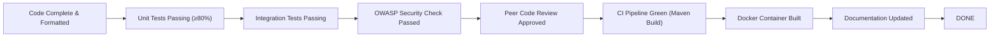

# Agile Planning & Product Management
## Venue Resource Booking System

---

## 1. Project Problem Statement

In academic institutions, research facilities, and modern enterprise environments, shared physical resources—such as auditorium halls, executive conference rooms, seminar rooms, computer laboratories, and specialized workshop spaces—are high-demand assets. Traditionally, managing these facilities relies on disjointed manual processes: paper-based logbooks, decentralized spreadsheets, ad-hoc email requests, and informal verbal agreements.

This manual operating paradigm suffers from critical systemic deficiencies:
1. **Double-Booking & Scheduling Conflicts**: Concurrent requests for the same time window frequently result in overlapping bookings, causing last-minute disruptions to vital academic and corporate events.
2. **Lack of Real-Time Visibility**: Users cannot readily verify venue availability, capacity, or amenities in real time, leading to wasted administrative overhead in iterative inquiries.
3. **Unstructured Approval Workflows**: Reservation approvals lack transparency, standardized review criteria, and formal accountability; rejections often occur without recorded justification.
4. **Absence of Governance & Audit Trails**: Modifications, cancellations, and status changes are not historically logged, leaving administrative teams unable to determine who approved or altered reservations.
5. **Zero Utilization Intelligence**: Facilities management lacks data on peak usage hours, booking density, venue underutilization, or capacity mismatches, preventing informed capital and maintenance investments.
6. **Infrastructure Fragility**: Legacy systems often run on isolated desktop machines or embedded storage without automated testing, database migration paths, or automated deployment pipelines.

The **Venue Resource Booking System** addresses these issues through a centralized, web-based platform with robust concurrency controls, role-based workflows, automated notifications, transparent audit trails, and data-driven utilization analytics.

---

## 2. Project Objectives

The primary engineering and business objectives of the system are:

- **Centralized Self-Service Portal**: Provide an intuitive, responsive web portal where faculty, staff, and students can discover venues, inspect schedules, and book rooms with instant validation.
- **Deterministic Concurrency & Conflict Prevention**: Implement zero-tolerance overlap prevention via transactional database isolation and pessimistic locking, guaranteeing that no two overlapping reservations can be confirmed for the same venue.
- **Tiered Approval Workflow**: Establish an asynchronous governance model wherein user submissions enter a `PENDING` state and require authenticated administrative review with compulsory rejection rationales.
- **Traceability & Regulatory Audit Logging**: Automatically record all business-critical mutations (creation, approval, rejection, cancellation, rescheduling) with user identity, timestamp, and metadata.
- **Actionable Operational Analytics**: Deliver administrative intelligence on utilization rates, peak booking hours, monthly trends, and automated alternative recommendations.
- **Enterprise-Grade Database Architecture**: Transition from in-memory prototyping to enterprise relational storage (PostgreSQL) using environment-isolated Spring profiles.
- **DevOps Continuous Delivery**: Implement end-to-end continuous integration and deployment automation (Git, Jenkins, Docker, Ansible) with automated quality gates and zero-downtime containerized releases.

---

## 3. Project Scope

### 3.1 In-Scope Capabilities
- **Authentication & Authorization**: Role-Based Access Control (RBAC) with `ROLE_USER` and `ROLE_ADMIN`, BCrypt password hashing, session management, and CSRF protection.
- **Venue Resource Catalog**: Administrative cataloging of facilities with capacity parameters, location descriptions, active/inactive availability toggling, and search/filter capabilities.
- **Smart Scheduling & Slot Validation**: Date and time window selection, past-date booking prevention, operating-window enforcement, and intelligent alternative recommendations when venues are occupied.
- **Lifecycle Approval Engine**: Full state machine transitions: `PENDING` → `APPROVED`, `REJECTED`, `CANCELLED`, and `COMPLETED`.
- **Audit Trails & Notifications**: Persistent event logging of state changes, in-app notification center with read/unread tracking, and optional asynchronous SMTP email dispatch.
- **Analytics & Reporting Dashboard**: Visual utilization statistics, status distributions, peak load analysis, and user-centric booking history.
- **Persistence & Migration**: Dual-profile persistence (H2 for fast local unit testing; PostgreSQL for production container environments) with automated schema management.
- **Automated CI/CD**: Jenkins declarative pipeline integrating Maven verification, Selenium UI tests, Docker image publishing, and Ansible remote deployment.

### 3.2 Out-of-Scope Capabilities (Future Iterations)
- Financial payment gateway integration (commercial venue rentals).
- Physical IoT smart lock and biometric hardware integration.
- Multi-tenant enterprise federation with SAML/Okta SSO.
- Real-time mobile push notifications (iOS/Android native apps).

---

## 4. Functional Requirements (FR)

| Requirement ID | Module | Description |
|---|---|---|
| **FR-01** | Authentication | The system shall permit new users to register with unique usernames, validated emails, and secure passwords (hashed via BCrypt). |
| **FR-02** | Access Control | The system shall enforce Spring Security RBAC, restricting administrative dashboards and management actions to users with `ROLE_ADMIN`. |
| **FR-03** | Venue Management | Administrators shall be able to create, update, inspect, and toggle active status for venues with defined seating capacity. |
| **FR-04** | Booking Creation | Authenticated users shall submit booking requests specifying venue, date, start time, end time, attendee count, and event purpose. |
| **FR-05** | Conflict Detection | The system shall prevent overlapping bookings for the same venue across identical date-time intervals using database-level locking. |
| **FR-06** | Alternative Suggestions | If a requested venue is unavailable, the system shall compute and recommend suitable alternative venues matching capacity requirements. |
| **FR-07** | Approval Workflow | Administrators shall approve or reject pending requests; mandatory text remarks must accompany all rejections. |
| **FR-08** | Booking Lifecycle | Users shall have the right to cancel their own `PENDING` or `APPROVED` bookings before the scheduled start time. |
| **FR-09** | Notifications | The system shall deliver in-app notification alerts upon booking submission, approval, rejection, rescheduling, and cancellation. |
| **FR-10** | Audit Logging | The system shall create an immutable audit record for every venue mutation, booking submission, approval action, and cancellation. |
| **FR-11** | Analytics Engine | The administrative dashboard shall compute total bookings, monthly trends, status distributions, peak days/hours, and utilization percentages. |
| **FR-12** | Database Portability | The persistence tier shall seamlessly operate against PostgreSQL in production while supporting H2 for offline development. |

---

## 5. Non-Functional Requirements (NFR)

| Requirement ID | Category | Specification |
|---|---|---|
| **NFR-01** | **Performance** | API endpoints and web page renders shall complete within 300ms under standard concurrency (up to 50 concurrent transactions). |
| **NFR-02** | **Concurrency Integrity** | Under high concurrent booking submissions for the same time slot, zero duplicate confirmations shall occur (Pessimistic Write Locking). |
| **NFR-03** | **Security (OWASP)** | Protection against OWASP Top 10: parameterized queries (SQL injection prevention), Thymeleaf HTML escaping (XSS prevention), CSRF token validation on all state-altering requests, secure cookie flags (`HttpOnly`, `SameSite=Lax`). |
| **NFR-04** | **Availability & Reliability** | System uptime target: 99.9%. Database transaction rollbacks must guarantee zero partial state commits in event of runtime exceptions. |
| **NFR-05** | **Scalability** | Relational schema configured with proper composite indexes on `(venue_id, booking_date, start_time, end_time, status)` to ensure sub-millisecond query execution as booking records scale. |
| **NFR-06** | **Maintainability & Testability** | Clean layered architecture (Controller → Service → Repository → Model). Mandatory unit and integration test coverage exceeding 80% on all service calculations. |
| **NFR-07** | **Usability & Responsiveness** | Consistent professional light theme (Navy `#1e3a8a`, Light Grey `#f8fafc`, White `#ffffff`) responsive across mobile (375px+), tablet, and desktop viewports. |
| **NFR-08** | **Deployability** | Containerized execution via multi-stage Docker build producing lightweight runtime images (<250MB) managed by Ansible playbooks. |

---

## 6. User Stories & Acceptance Criteria

### US-01: User Self-Registration & Authentication
- **As a** campus member,
- **I want to** register an account with my credentials and log into the portal,
- **So that** I can securely access venue reservation services.
- **Acceptance Criteria**:
  - Validates non-empty username, unique email format, and password minimum length (6 characters).
  - Password stored exclusively as a BCrypt one-way salt hash.
  - Displays clear error alerts for invalid credentials or duplicate accounts.
  - Default role assigned is `ROLE_USER`.
- **Estimate**: 5 Story Points | **Priority**: Must Have

### US-02: Venue Discovery & Availability Inspection
- **As a** registered user,
- **I want to** browse active venues, view capacities, and inspect available time slots for a given date,
- **So that** I can plan my meeting in an appropriate, available facility.
- **Acceptance Criteria**:
  - Inactive venues are filtered from public booking views.
  - Visual badges distinguish available vs. reserved hourly slots.
  - Capacity details and descriptions are clearly presented.
- **Estimate**: 5 Story Points | **Priority**: Must Have

### US-03: Conflict-Free Booking Submission
- **As a** registered user,
- **I want to** select a date and start/end time window and submit a booking request,
- **So that** I can reserve a venue for my event without collision with existing events.
- **Acceptance Criteria**:
  - End time must strictly follow start time.
  - Selected date cannot be in the past.
  - Requested attendees cannot exceed venue capacity.
  - Submission triggers a pessimistic check; overlapping `PENDING` or `APPROVED` requests are rejected.
  - Initial booking status is set to `PENDING`.
- **Estimate**: 8 Story Points | **Priority**: Must Have

### US-04: Smart Alternative Venue Recommendations
- **As a** user booking an occupied venue,
- **I want to** receive instant recommendations for alternative venues that fit my capacity and time slot,
- **So that** I can book an available space without restarting my search.
- **Acceptance Criteria**:
  - If target venue is booked, algorithm queries all active venues with `capacity >= requested_attendees`.
  - Filters out venues with conflicts during the requested window.
  - Presents available candidates with a 1-click booking link.
- **Estimate**: 5 Story Points | **Priority**: Should Have

### US-05: User Booking Management & Self-Cancellation
- **As a** registered user,
- **I want to** review my booking history, track approval status, and cancel eligible bookings,
- **So that** I can manage my schedule and free up facilities when events are cancelled.
- **Acceptance Criteria**:
  - Displays user's bookings categorized by status (`PENDING`, `APPROVED`, `REJECTED`, `CANCELLED`).
  - Users can cancel only their own `PENDING` or `APPROVED` future reservations.
  - Cancellation frees up the venue time slot immediately.
- **Estimate**: 5 Story Points | **Priority**: Must Have

### US-06: Administrative Venue Management
- **As an** administrator,
- **I want to** add new venues, modify capacities, and toggle operational status,
- **So that** the system accurately reflects real-world facility availability.
- **Acceptance Criteria**:
  - Admin-only routes protected by `hasRole('ADMIN')`.
  - Validation prevents zero or negative capacities.
  - Inactive venues cannot accept new reservations.
- **Estimate**: 5 Story Points | **Priority**: Must Have

### US-07: Administrative Booking Approval & Rejection Engine
- **As an** administrator,
- **I want to** review pending requests and approve or reject them with mandatory remarks,
- **So that** facility usage is appropriately governed and users receive clear explanations.
- **Acceptance Criteria**:
  - Admin approval dashboard lists all pending requests sorted chronologically.
  - Approving changes state to `APPROVED` and records the admin identity.
  - Rejecting prompts for a mandatory text explanation and changes state to `REJECTED`.
  - Rejection releases the venue slot for other applicants.
- **Estimate**: 8 Story Points | **Priority**: Must Have

### US-08: Booking Audit History & Regulatory Tracking
- **As an** auditor or administrator,
- **I want to** view a chronological audit history of all status changes on a booking,
- **So that** every transition is attributable and accountable.
- **Acceptance Criteria**:
  - Table records `booking_id`, `previous_status`, `new_status`, `action_by`, `timestamp`, and `remarks`.
  - Audit records are immutable; no update or delete operations permitted.
- **Estimate**: 5 Story Points | **Priority**: Should Have

### US-09: In-App User Notifications
- **As a** user,
- **I want to** receive notifications inside the web application when my booking status changes,
- **So that** I am immediately alerted to approvals, rejections, or admin notes.
- **Acceptance Criteria**:
  - Navbar displays an unread notification counter badge.
  - Notifications list shows event timestamp, message, and read/unread toggle.
  - Mark-as-read updates count asynchronously or via page reload.
- **Estimate**: 5 Story Points | **Priority**: Should Have

### US-10: Enterprise Administrative Audit Log Dashboard
- **As a** security administrator,
- **I want to** filter and search system-wide audit logs across users, actions, and dates,
- **So that** I can detect anomalous behavior and maintain security compliance.
- **Acceptance Criteria**:
  - Search and filter by username, action type (`VENUE_CREATE`, `BOOKING_SUBMIT`, `BOOKING_APPROVE`, etc.), and date range.
  - Paginated display with newest activities first.
- **Estimate**: 5 Story Points | **Priority**: Should Have

### US-11: Executive Analytics & Venue Utilization Reporting
- **As an** operations director,
- **I want to** view aggregate statistics, utilization rates, and peak usage hours,
- **So that** I can optimize resource allocation and scheduling policies.
- **Acceptance Criteria**:
  - Computes utilization percentage: `(Total Booked Hours / Total Operational Hours) * 100`.
  - Displays monthly booking trends, status distribution, peak days, and peak hours.
  - Handles zero-booking baseline gracefully without divide-by-zero errors.
- **Estimate**: 8 Story Points | **Priority**: Should Have

### US-12: Production PostgreSQL Migration & Dual-Profile Persistence
- **As a** DevOps engineer,
- **I want the** application to support seamless execution against PostgreSQL in staging/production while keeping H2 for unit testing,
- **So that** production data is persistently stored with ACID safety without slowing down local builds.
- **Acceptance Criteria**:
  - `application-dev.properties` uses H2 in-memory storage.
  - `application-prod.properties` connects to PostgreSQL via environment variables (`DB_URL`, `DB_USERNAME`, `DB_PASSWORD`).
  - Schema, indexes, and foreign keys cleanly initialize across both dialects.
- **Estimate**: 8 Story Points | **Priority**: Must Have

### US-13: Modern Responsive UI & Accessibility
- **As an** end user on any device,
- **I want to** experience a consistent, professional, and accessible user interface,
- **So that** navigation is effortless across smartphones, tablets, and desktop workstations.
- **Acceptance Criteria**:
  - Shared Thymeleaf layout fragments for navigation, header, alerts, and footer.
  - Professional color palette: Navy Blue (`#1e3a8a`), Slate (`#475569`), Light Slate (`#f8fafc`).
  - Mobile responsive toggle menu and fluid grid systems.
- **Estimate**: 5 Story Points | **Priority**: Must Have

### US-14: Jenkins Automated Continuous Integration
- **As a** developer,
- **I want** every commit to trigger automated Maven compilation, testing, and packaging in Jenkins,
- **So that** integration regressions are caught within minutes of push.
- **Acceptance Criteria**:
  - `Jenkinsfile` runs `mvn clean verify` with zero test failures.
  - Generates surefire test reports.
  - Build failure halts pipeline immediately.
- **Estimate**: 5 Story Points | **Priority**: Must Have

### US-15: Containerized Packaging & Docker Hub Publishing
- **As a** release engineer,
- **I want** successful builds to automatically build a Docker container and push it to Docker Hub,
- **So that** deployment artifacts are immutable, versioned, and reproducible.
- **Acceptance Criteria**:
  - Multi-stage Dockerfile produces an optimized Java 21 runtime container.
  - Image tagged with build ID and semantic version.
  - Credentials retrieved securely from Jenkins credential vault.
- **Estimate**: 5 Story Points | **Priority**: Must Have

### US-16: Ansible Automated Provisioning & Deployment
- **As a** systems administrator,
- **I want** Ansible playbooks to provision target Ubuntu virtual machines and deploy the latest Docker container,
- **So that** production releases are hands-free and repeatable.
- **Acceptance Criteria**:
  - Playbook installs Docker and dependencies on target hosts.
  - Stops previous container, pulls newest image, and launches application with production profile.
  - Health check verification confirms port 8080 responds with HTTP 200.
- **Estimate**: 5 Story Points | **Priority**: Must Have

---

## 7. Product Backlog

| Backlog ID | Story ID | Title | Business Value | Story Points | MoSCoW Priority | Target Sprint |
|---|---|---|---|---|---|---|
| **PB-01** | US-01 | User Registration, Authentication & RBAC | High | 5 | Must Have | Sprint 1 |
| **PB-02** | US-13 | Modern UI Layout, Theme & Thymeleaf Fragments | High | 5 | Must Have | Sprint 1 |
| **PB-03** | US-06 | Admin Venue Management & Catalog Configuration | High | 5 | Must Have | Sprint 2 |
| **PB-04** | US-02 | Venue Discovery & Slot Availability View | High | 5 | Must Have | Sprint 2 |
| **PB-05** | US-03 | Smart Scheduling & Concurrency Conflict Prevention | Critical | 8 | Must Have | Sprint 2 |
| **PB-06** | US-04 | Alternative Venue Recommendation Engine | Medium | 5 | Should Have | Sprint 2 |
| **PB-07** | US-07 | Multi-Tier Approval & Rejection Engine | Critical | 8 | Must Have | Sprint 3 |
| **PB-08** | US-05 | User Booking Lifecycle & Cancellation | High | 5 | Must Have | Sprint 3 |
| **PB-09** | US-08 | Booking Status History & Audit Tracking | High | 5 | Should Have | Sprint 3 |
| **PB-10** | US-09 | In-App User Notifications & Alert Center | Medium | 5 | Should Have | Sprint 3 |
| **PB-11** | US-10 | Admin Audit Dashboard & Security Activity Tracking | Medium | 5 | Should Have | Sprint 3 |
| **PB-12** | US-11 | Executive Analytics & Utilization Metrics Engine | High | 8 | Should Have | Sprint 4 |
| **PB-13** | US-12 | PostgreSQL Dual-Profile Migration & Persistence | Critical | 8 | Must Have | Sprint 4 |
| **PB-14** | US-14 | Jenkins CI Automated Build & Verification Pipeline | Critical | 5 | Must Have | Sprint 4 |
| **PB-15** | US-15 | Dockerfile Multi-Stage Build & Docker Hub Registry | High | 5 | Must Have | Sprint 4 |
| **PB-16** | US-16 | Ansible Automated Virtual Machine Deployment | High | 5 | Must Have | Sprint 4 |

**Total Estimated Backlog Effort**: 92 Story Points across 4 Sprints (Average velocity: 23 points/sprint).

---

## 8. Sprint Planning

### Sprint 1: Foundation, User Authentication, Session Security & Modern UI
- **Sprint Goal**: Deliver a secure user authentication portal wrapped in a responsive, modern UI layout.
- **Sprint Backlog**: PB-01 (US-01), PB-02 (US-13).
- **Committed Points**: 10 Story Points.
- **Detailed Tasks**:
  1. Configure Spring Security 6 with `SecurityFilterChain` and CSRF protection.
  2. Implement `User` entity, `UserRepository`, and `CustomUserDetailsService`.
  3. Create BCrypt password encoding service.
  4. Develop registration and login forms with real-time field validation messages.
  5. Build reusable Thymeleaf fragments: `navbar.html`, `footer.html`, `alerts.html`.
  6. Define responsive CSS styles using Navy/Slate color hierarchy.
  7. Write unit tests for user registration and authentication controllers.
- **Sprint Deliverable**: Deployable web application permitting secure registration, login/logout, and responsive dashboard shell.

---

### Sprint 2: Venue Catalog, Smart Scheduling & Conflict-Free Booking
- **Sprint Goal**: Enable users to discover venues, inspect live availability, book reservations with zero collision risk, and view smart alternatives.
- **Sprint Backlog**: PB-03 (US-06), PB-04 (US-02), PB-05 (US-03), PB-06 (US-04).
- **Committed Points**: 23 Story Points.
- **Detailed Tasks**:
  1. Implement `Venue` entity, `VenueRepository`, and `VenueService`.
  2. Develop administrative venue management portal (add, edit, toggle availability).
  3. Implement date picker and slot calculation engine in `BookingService`.
  4. Implement conflict detection algorithm: check `(startA < endB) && (endA > startB)` for identical venues and dates.
  5. Apply database-level pessimistic locking (`PESSIMISTIC_WRITE`) to prevent race conditions during concurrent bookings.
  6. Develop smart alternative suggestion query finding non-conflicting active venues with equal or greater capacity.
  7. Write unit and integration tests simulating concurrent reservation attempts.
- **Sprint Deliverable**: Functional booking engine with strict conflict prevention and fallback alternative recommendations.

---

### Sprint 3: Governance Workflow, Lifecycle History, Notifications & Audit Logs
- **Sprint Goal**: Introduce an administrative approval engine with full state machine transitions, audit history, and notification alerts.
- **Sprint Backlog**: PB-07 (US-07), PB-08 (US-05), PB-09 (US-08), PB-10 (US-09), PB-11 (US-10).
- **Committed Points**: 28 Story Points.
- **Detailed Tasks**:
  1. Refactor `BookingStatus` enum to include `PENDING`, `APPROVED`, `REJECTED`, `CANCELLED`, `COMPLETED`.
  2. Implement `BookingHistory` entity to capture all status transitions, timestamps, actors, and remarks.
  3. Build administrative approval dashboard with status filter tabs and modal for rejection rationales.
  4. Implement user self-cancellation logic for future reservations.
  5. Develop `AppNotification` entity and `NotificationService` for in-app alert broadcasting.
  6. Create in-app notification center dropdown with badge counters and mark-as-read endpoints.
  7. Implement `AuditLog` entity and aspect/service to record security and management events.
  8. Build administrative audit inspection dashboard with filtering by user, action, and date.
  9. Add optional `EmailService` integration using Spring JavaMailSender for asynchronous email dispatch.
- **Sprint Deliverable**: End-to-end governed reservation workflow with full traceability and proactive user alerting.

---

### Sprint 4: Analytics Engine, PostgreSQL Migration & Production CI/CD
- **Sprint Goal**: Equip administrators with utilization analytics, migrate to PostgreSQL persistence, and automate end-to-end CI/CD delivery.
- **Sprint Backlog**: PB-12 (US-11), PB-13 (US-12), PB-14 (US-14), PB-15 (US-15), PB-16 (US-16).
- **Committed Points**: 31 Story Points.
- **Detailed Tasks**:
  1. Develop `AnalyticsService` calculating monthly booking trends, status distribution, peak hours, and utilization rates.
  2. Build interactive administrative analytics dashboard with Chart.js visualization.
  3. Author `application-prod.properties` configured for PostgreSQL with connection pooling.
  4. Implement data migration and validation scripts ensuring zero data loss during schema transition.
  5. Containerize application with multi-stage `Dockerfile` and `docker-compose.yml`.
  6. Configure Jenkins declarative pipeline (`Jenkinsfile`) with build, test, package, and container push stages.
  7. Author Ansible playbooks (`deploy-app.yml`) automating VM provisioning, Docker pull, and zero-downtime container launch.
  8. Run comprehensive verification test suite (90+ unit and integration tests).
- **Sprint Deliverable**: Production-ready, containerized, automated delivery pipeline with analytics and enterprise PostgreSQL persistence.

---

## 9. Definition of Done (DoD)

Before any User Story or task can transition to the **DONE** state, it must satisfy all of the following quality gates:



### Mandatory DoD Checklist:
- [ ] **Functional Correctness**: All acceptance criteria defined in the user story are completely satisfied and verified.
- [ ] **Clean Code & Formatting**: Code conforms to Google Java Style conventions, free of unused imports, dead code, or magic numbers.
- [ ] **Unit Test Coverage**: Comprehensive JUnit 5 and Mockito tests written, achieving ≥80% code coverage on new service methods.
- [ ] **Integration Verification**: Spring Boot `@SpringBootTest` slices succeed with zero regressions (`mvn clean verify`).
- [ ] **Security Validation**: All endpoints protected by Spring Security authorizations; CSRF tokens present on all forms; zero raw SQL injection vectors.
- [ ] **Database Integrity**: JPA entity relationships, cascading rules, and indexes validated across both H2 and PostgreSQL dialects.
- [ ] **Code Review**: Pull request reviewed and approved by at least one peer reviewer with zero unresolved feedback comments.
- [ ] **CI Pipeline Validation**: Jenkins CI / automated build verifies branch cleanly without test failures or build warnings.
- [ ] **Container Packaging**: Multi-stage Docker build succeeds, and container boots cleanly with active health check.
- [ ] **Documentation**: Project documentation (`README.md`, release notes, or architecture docs) updated to reflect any new capability or environment variables.

---

## 10. Kanban Workflow & WIP Limits

To maintain flow efficiency, eliminate multitasking waste, and surface integration bottlenecks immediately, the development team operates under a structured **Kanban Board** with explicit **Work In Progress (WIP)** limits.

### 10.1 Board Architecture & Work Stages

| Stage | Column Name | WIP Limit | Entrance Criteria | Exit Criteria |
|---|---|:---:|---|---|
| 1 | **Product Backlog** | &infin; | User story authored with acceptance criteria and estimated in story points. | Story prioritized by Product Owner for upcoming work. |
| 2 | **To Do (Ready for Dev)** | **4** | Story meets Definition of Ready (DoR); dependencies resolved; test scenarios identified. | Developer assigns story and moves card to *In Progress*. |
| 3 | **In Progress** | **2** | Developer actively authoring code and unit tests on a dedicated `feature/*` branch. | Code written, unit tests passing locally, branch pushed to GitHub. |
| 4 | **Code Review / PR** | **2** | Pull Request opened against `develop` using standard PR template; CI verification green. | At least one approving peer review; all comments resolved. |
| 5 | **CI / Staging Testing** | **2** | PR merged into `develop`; automated Jenkins build deployed to staging container. | Automated regression and integration tests pass; manual smoke test confirmed. |
| 6 | **Done** | &infin; | Satisfies all Definition of Done (DoD) criteria; signed off by product owner. | Deployed to production release candidate. |

### 10.2 Kanban Board Visual Layout

```
+------------------+------------------+------------------+------------------+------------------+------------------+
| PRODUCT BACKLOG  |      TO DO       |   IN PROGRESS    |   CODE REVIEW    |    CI/STAGING    |       DONE       |
|   (Unlimited)    |     (WIP: 4)     |     (WIP: 2)     |     (WIP: 2)     |     (WIP: 2)     |   (Unlimited)    |
+------------------+------------------+------------------+------------------+------------------+------------------+
| [PB-11] Audit UI | [PB-04] Slots UI | [PB-05] Concurr. | [PB-03] Venues   | [PB-01] Auth UI  | [MVP-01] Landing |
| [PB-12] Analysis | [PB-06] Suggest. | [PB-07] Approval | [PB-08] Cancel   | [PB-02] Theme    | [MVP-02] Reg.    |
| [PB-13] Postgres |                  |                  |                  |                  | [MVP-03] Login   |
| [PB-14] Jenkins  |                  | (STRICT LIMIT)   | (STRICT LIMIT)   | (STRICT LIMIT)   |                  |
+------------------+------------------+------------------+------------------+------------------+------------------+
```

### 10.3 Why WIP Limit = 2 is Enforced
1. **Context-Switching Minimization**: Software engineers lose up to 40% of productive focus when juggling multiple active tasks. A strict WIP of 2 limits a developer or pair to one primary task and one secondary task (or pairing support).
2. **Immediate Bottleneck Identification**: If the *Code Review* column reaches 2 items, developers in *In Progress* are prohibited from pulling new work from *To Do*. Instead, they must swarm on reviewing outstanding PRs, clearing the bottleneck.
3. **Optimized Cycle Time & Lead Time**: According to Little's Law ($Lead\ Time = \frac{WIP}{Throughput}$), reducing Work In Progress directly shortens lead time, allowing features to reach production faster with fewer defect escapes.
4. **Enhanced Pair Programming & Swarming**: When a task in *In Progress* or *CI/Staging* is blocked, engineers immediately collaborate on resolving the blockage rather than starting unvetted speculative code.
