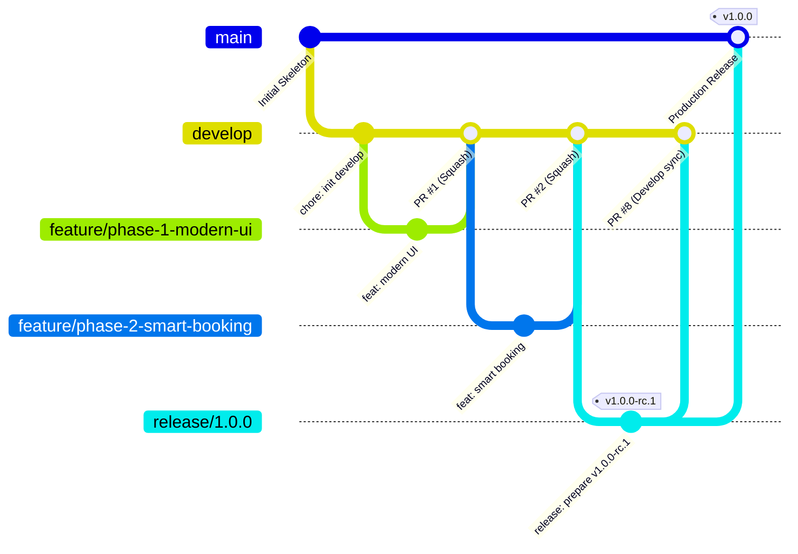
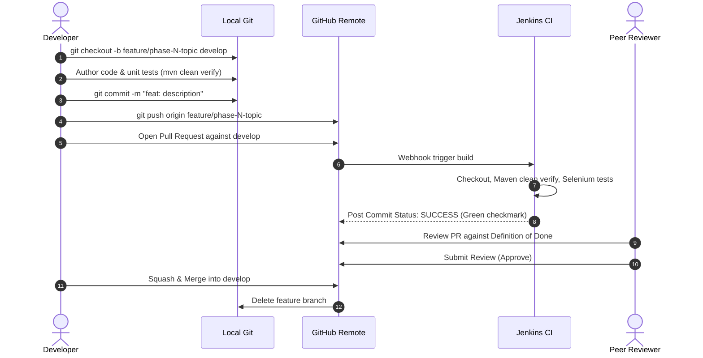

# Git & GitHub Workflow Specification
## Venue Resource Booking System

---

## 1. Repository Architecture & Branching Strategy

The Venue Resource Booking System adheres to a customized **GitFlow** branching model tailored for continuous integration and automated deployment with Jenkins, Docker, and Ansible.



### 1.1 Branch Taxonomy

| Branch Category | Naming Convention | Base Branch | Target Merge Branch | Purpose & Lifecycle |
|---|---|---|---|---|
| **Production** | `main` | N/A | None | Contains permanently stable, production-ready code. Every commit to `main` corresponds to a production deployment tag. Protected branch (direct push prohibited). |
| **Integration** | `develop` | `main` | `main` (via release) | Aggregates completed, tested feature branches. Acts as the staging integration baseline for automated nightly regression runs. |
| **Feature Branches** | `feature/<issue-id>-<short-description>` or `feature/phase-<N>-<topic>` | `develop` | `develop` | Short-lived branches dedicated to a specific user story or enhancement phase. Deleted after successful merge. |
| **Release Branches** | `release/<major>.<minor>.<patch>` | `develop` | `main` and `develop` | Prepared when features for a release milestone are frozen. Used for minor bug fixes, version bump, and release candidate validation (e.g., `v1.0.0-rc.1`). |
| **Hotfix Branches** | `hotfix/<issue-id>-<description>` | `main` | `main` and `develop` | Emergency production patches bypassing `develop`. Merged back to both `main` and `develop` immediately upon resolution. |

### 1.2 Current Repository State Audit
- **Default Branch**: `main`
- **Active Integration Branch**: `develop`
- **Active Release Branch**: `release/1.0.0` (Tagged `v1.0.0-rc.1` at commit `b0997c6`)
- **Enhancement Phase Branches**:
  - `feature/phase-1-modern-ui` (Commit `7b33fae`)
  - `feature/phase-2-smart-booking` (Commit `d90144e`)
  - `feature/phase-3-approval-workflow` (Commit `b581e66`)
  - `feature/phase-4-analytics` (Commit `9bd7f87`)
  - `feature/phase-5-postgresql` (Commit `df882b1`)
  - `feature/phase-6-audit-notifications` (Commit `89eaace`)
  - `feature/phase-7-agile-git-workflow` (Active work branch)
- **Historical Integration Branches**:
  - `feature/3-booking-workflow` (Merged via PR #6)
  - `feature/4-csrf-security` (Merged via PR #7)
  - `feature/5-jenkins-ci`
  - `feature/6-jenkins-docker`
  - `docs/release-status-update` (Used for merge conflict demonstration)

---

## 2. Commit Naming Convention (Conventional Commits)

To ensure machine-readable changelogs and clean historical auditing, all commits must adhere to the **Conventional Commits 1.0.0** specification.

### 2.1 Commit Message Structure
```text
<type>(<optional scope>): <imperative description>

[optional body explaining 'what' and 'why', not 'how']

[optional footer referencing issue or breaking change]
```

### 2.2 Standard Commit Types

| Type | Purpose | Example |
|---|---|---|
| `feat` | Introduces a new functional capability | `feat(booking): add pessimistic locking for concurrent slots` |
| `fix` | Corrects an identified defect or bug | `fix(csrf): restore CSRF token in booking cancellation form` |
| `docs` | Documentation modifications exclusively | `docs(git): document branch merge conflict resolution` |
| `test` | Adding missing unit/integration tests or refactoring existing tests | `test(analytics): add unit tests for peak hour calculations` |
| `ci` | CI/CD pipeline modifications (Jenkins, Dockerfile, Ansible) | `ci(jenkins): automate Docker Hub image publishing stage` |
| `refactor` | Code restructuring without altering external functionality | `refactor(auth): simplify user details service loading` |
| `perf` | Performance enhancement or query optimization | `perf(repository): add composite index on booking interval` |
| `chore` | Maintenance tasks, dependency updates, configuration tweaks | `chore(pom): upgrade postgresql driver to version 42.7.2` |
| `release` | Release candidate preparation and version bumps | `release: prepare v1.0.0-rc.1` |

### 2.3 Commit Best Practices
1. **Imperative Mood**: Use "add" instead of "added", "fix" instead of "fixed".
2. **Atomic Commits**: Each commit should encompass a single logical change that passes compilation and testing.
3. **Traceability**: Reference corresponding backlog items or issue numbers in footers (e.g., `Resolves: #15`).

---

## 3. Pull Request (PR) Workflow

All code contributions to `develop` or `main` must flow through GitHub Pull Requests. Direct pushes to `develop` and `main` are strictly blocked by branch protection rules.



### 3.1 Step-by-Step PR Lifecycle

#### Step 1: Branch Creation
Always pull the latest integration state before branching:
```bash
git checkout develop
git pull origin develop
git checkout -b feature/phase-7-agile-git-workflow
```

#### Step 2: Local Verification
Prior to pushing any branch, execute full local test suite verification:
```bash
mvn clean verify
```
*Zero compilation errors and 100% test pass rate required.*

#### Step 3: Remote Push & PR Submission
Push the feature branch to GitHub and instantiate a PR targeting `develop`:
```bash
git push -u origin feature/phase-7-agile-git-workflow
```
On GitHub, populate the Pull Request utilizing the standard template (`.github/PULL_REQUEST_TEMPLATE.md`).

#### Step 4: Automated CI Gating
Jenkins executes the declarative pipeline:
- Compiles source code.
- Runs unit tests (`*Test.java`).
- Runs integration slices (`*IT.java`).
- Confirms zero regressions. Only green builds qualify for review.

#### Step 5: Peer Code Review & Sign-Off
- At least one authorized peer reviewer must approve the PR.
- Reviewer verifies adherence to Definition of Done (DoD), architectural boundaries, security safeguards, and test coverage.

#### Step 6: Merge & Cleanup
- The PR is merged into `develop` using **Squash and Merge** (or semi-linear rebase).
- The remote feature branch is safely deleted.

---

## 4. Merge Strategies

To maintain an optimal balance between granular developer history and clean, readable repository history, the project adopts differentiated merge strategies:

### 4.1 Feature Branches into `develop` &rarr; **Squash & Merge**
- **Strategy**: Combines all intermediate development commits on the feature branch into a single, cohesive commit on `develop`.
- **Rationale**: Keeps `develop` history linear, clean, and easily bisectable. Individual WIP commits ("fix typo", "adjust test") do not clutter the shared branch.
- **Commit Format**:
  ```text
  feat(phase-7): implement agile planning and git workflow documentation (#9)
  ```

### 4.2 `develop` into `release/*` & `main` &rarr; **Merge Commit (`--no-ff`)**
- **Strategy**: Preserves explicit branch topology and merge points.
- **Rationale**: Retains the historical provenance of releases, clearly showing when a release branch was cut, audited, tagged, and deployed to production.

---

## 5. Concrete Demonstration: Feature Branch & PR Workflow

Below is a live walkthrough demonstrating how **Phase 7** was executed using this disciplined workflow:

### 5.1 Step 1: Branch Initialization
```bash
# Verify current status and ensure clean working tree
git status
# Checkout latest integration baseline
git checkout develop
# Create feature branch
git checkout -b feature/phase-7-agile-git-workflow
```

### 5.2 Step 2: Implementation of Deliverables
Documentation and process assets authored:
- `docs/AGILE_PLANNING.md` (Agile planning, backlog, sprints, DoD, Kanban).
- `docs/GIT_WORKFLOW.md` (GitFlow, PR workflow, merge strategies, conflict resolution).
- `.github/PULL_REQUEST_TEMPLATE.md` (Standardized PR checklist).
- `README.md` (Updated cross-references).

### 5.3 Step 3: Verification & Test Execution
```bash
mvn clean verify
```
*Result: 93 tests run, 0 failures, 0 errors, 0 skipped. Build SUCCESS.*

### 5.4 Step 4: Staging & Conventional Commit
```bash
git add docs/AGILE_PLANNING.md docs/GIT_WORKFLOW.md .github/PULL_REQUEST_TEMPLATE.md README.md
git commit -m "docs(agile-git): author comprehensive agile planning and git workflow documentation"
```

### 5.5 Step 5: Push to Origin
```bash
git push -u origin feature/phase-7-agile-git-workflow
```

---

## 6. Documented Merge Conflict Resolution Walkthrough

Merge conflicts occur when two branches modify the identical line of a file or when a file is modified on one branch and deleted on another. Git halts the merge and injects conflict markers.

### 6.1 The Repository Merge Conflict Case Study
In this repository, a real-world conflict scenario is preserved in `docs/git-conflict-demo/release-status.txt`.

#### Context:
- Branch `HEAD` (or `develop`) updated the release status to `Feature Development`.
- Branch `docs/release-status-update` updated the exact same line to `Integration Review`.
- A merge between these branches resulted in a conflict.

### 6.2 Examining Conflict Markers
When inspecting `docs/git-conflict-demo/release-status.txt`, Git presents:

```text
<<<<<<< HEAD
Release Status: Feature Development 
=======
Release Status: Integration Review 
>>>>>>> docs/release-status-update
```

#### Anatomy of Conflict Markers:
- `<<<<<<< HEAD`: Indicates the beginning of the conflicting change in the target branch (the branch currently checked out).
- `=======`: The separator dividing the divergent changes between the two branches.
- `>>>>>>> docs/release-status-update`: Indicates the end of the conflicting change from the incoming branch being merged.

### 6.3 Step-by-Step Conflict Resolution Procedure

#### Step 1: Identify Conflicting Files
Run `git status` to locate unmerged paths:
```bash
git status
# Output indicates:
# both modified: docs/git-conflict-demo/release-status.txt
```

#### Step 2: Understand Business Intent & Harmonize
Consult with team members or inspect PR intent:
- `HEAD` indicates feature work is actively proceeding.
- `docs/release-status-update` indicates feature work has closed and integration QA has commenced.
- **Resolution Decision**: Harmonize the status to reflect that feature development is finalized and integration review is in progress:
  ```text
  Release Status: Feature Development Completed - Integration Review in Progress
  ```

#### Step 3: Edit File & Remove All Markers
Open the file in an editor, delete the conflict markers (`<<<<<<<`, `=======`, `>>>>>>>`), and save the unified content:

```text
Release Status: Feature Development Completed - Integration Review in Progress
```

#### Step 4: Compile & Test to Ensure Zero Side-Effects
Before staging, verify that the resolution did not introduce syntax errors or broken tests:
```bash
mvn test-compile
```

#### Step 5: Stage the Resolved File
Tell Git the conflict is resolved by staging the file:
```bash
git add docs/git-conflict-demo/release-status.txt
```

#### Step 6: Finalize the Merge Commit
Complete the merge commit with a descriptive resolution message:
```bash
git commit -m "merge: resolve release status conflict between HEAD and docs/release-status-update"
```

#### Step 7: Verify History
Verify clean branch state and commit history:
```bash
git status
git log --graph --oneline -n 3
```

---

## 7. Release Tagging Strategy (Semantic Versioning)

The project strictly follows **Semantic Versioning 2.0.0 (SemVer)**:

$$\text{Format: } \mathbf{vMAJOR.MINOR.PATCH[-PRERELEASE]}$$

```
   v 1 . 0 . 0 - rc.1
     │   │   │     │
     │   │   │     └── Pre-release Identifier (Release Candidate 1)
     │   │   └──────── Patch Version (Bug fixes, security patches)
     │   └──────────── Minor Version (New backward-compatible features)
     └──────────────── Major Version (Breaking architectural changes)
```

### 7.1 SemVer Rule Matrix

| Component | Trigger Criterion | Example |
|---|---|---|
| **MAJOR** | Breaking schema changes, major Spring Boot framework overhaul, incompatible API redesign. | `v2.0.0` |
| **MINOR** | Backwards-compatible functional enhancements (e.g., adding Analytics module or Notification engine). | `v1.1.0` |
| **PATCH** | Backwards-compatible bug fixes, CSRF patches, security vulnerability mitigations. | `v1.0.1` |
| **PRE-RELEASE** | Staging validation candidates prior to production sign-off. | `v1.0.0-rc.1` |

### 7.2 Release Tagging Lifecycle

1. **Tag Creation on Release Branch**:
   Annotated tags must be used to record the tagger identity, date, and release notes:
   ```bash
   git tag -a v1.0.0-rc.1 -m "Venue Resource Booking System Release Candidate 1"
   ```
2. **Pushing Tags to GitHub**:
   ```bash
   git push origin v1.0.0-rc.1
   ```
3. **Production Tagging on `main`**:
   Upon final stakeholder sign-off and Ansible production deployment:
   ```bash
   git checkout main
   git merge --no-ff release/1.0.0 -m "release: deploy v1.0.0 to production"
   git tag -a v1.0.0 -m "Venue Resource Booking System Production Release v1.0.0"
   git push origin main --tags
   ```
4. **GitHub Releases Synchronization**:
   Each Git tag triggers automated generation of a GitHub Release containing:
   - Release changelog aggregated from Conventional Commits.
   - Pre-built executable jar artifact (`venue-booking-system-1.0.0.jar`).
   - Docker image digest reference (`rishirp15/venue-booking-system:1.0.0`).

---

## 8. Git History Integrity & Safety Guidelines

To protect team velocity and production stability, the following governance rules are enforced:

> [!CAUTION]
> **Zero History Rewriting on Shared Branches**:
> Commands that rewrite commit hashes—including `git rebase -i`, `git commit --amend` (after push), and `git filter-branch`—are **strictly prohibited** on `main`, `develop`, and active `release/*` branches.

> [!WARNING]
> **No Force Pushing (`--force`)**:
> Force-pushing destroys peer commits and breaks local developer clones. Force-push permissions are permanently disabled on GitHub repository settings for protected branches.

> [!NOTE]
> **Branch Retention Policy**:
> Historical feature branches (`feature/1-...`, `feature/phase-...`) are preserved in the repository archives to maintain complete traceability for academic and security audits. No branches are deleted without team-wide consensus.
